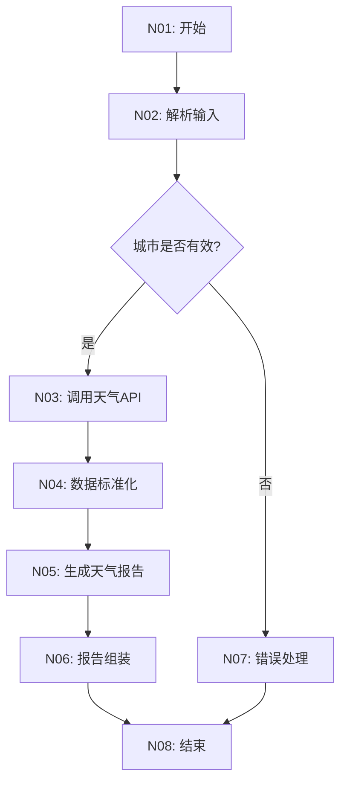

# 天气查询助手 - 极视角平台工作流设计

## 业务目标
根据用户输入的城市名称和日期（可选），查询实时天气信息或天气预报，并以友好的自然语言形式返回给用户。

## 边界条件
- 支持中国主要城市及国际热门城市
- 支持查询当天天气和未来7天预报
- 数据来源：通过MCP工具调用外部天气API
- 不支持历史天气查询

## 开始节点参数
| 变量 | 类型 | 必填 | 说明 |
|---|---|---|---|
| query | string | 否 | 用户原始问题（平台默认） |
| data | string | 是 | JSON格式：{"city": "城市名", "date": "日期(可选)"}

## 节点图



## 节点详细设计

### N02: 解析输入 (代码节点)
**输入变量：**
- data: string - 原始JSON字符串

**输出变量：**
- city: string - 标准化城市名
- date: string - 查询日期，默认今天
- is_valid: boolean - 输入是否有效
- error_msg: string - 错误信息（如果无效）

**职责：**
1. 解析JSON输入
2. 校验城市名称非空
3. 标准化日期格式（支持"今天"、"明天"、具体日期）
4. 设置默认值

**失败条件：**
- JSON解析失败
- 城市名为空

### N03: 调用天气API (MCP工具节点)
**输入变量：**
- city: string - 标准化城市名
- date: string - 查询日期

**输出变量：**
- raw_weather: dict - 原始天气数据
- is_error: number - 是否出错（0成功，1失败）
- content: array[dict] - API返回内容

**MCP配置：**
- 服务ID: 需配置天气服务
- 工具名: get_weather
- 超时: 10秒

### N04: 数据标准化 (代码节点)
**输入变量：**
- raw_weather: dict - 原始天气数据
- is_error: number - API调用状态

**输出变量：**
- weather_info: dict - 结构化天气数据
- has_data: boolean - 是否有有效数据

**weather_info结构：**
```json
{
  "city": "城市名",
  "date": "2026-08-18",
  "temperature": {"current": 28, "min": 22, "max": 32},
  "condition": "晴",
  "humidity": 65,
  "wind_speed": 3,
  "wind_direction": "东南风",
  "air_quality": "良",
  "uv_index": "强",
  "sunrise": "05:30",
  "sunset": "19:20",
  "tips": ["注意防晒", "适宜户外活动"]
}
```

### N05: 生成天气报告 (模型节点)
**输入变量：**
- weather_info: dict - 结构化天气数据
- city: string - 城市名
- date: string - 日期

**输出变量：**
- text: string - Markdown格式天气报告

**模型提示词要点：**
- 角色：专业气象播报员
- 输出格式：固定标题Markdown
- 内容要求：
  - 温度概况（当前/最高/最低）
  - 天气状况描述
  - 生活指数建议（穿衣、出行、运动）
  - 特别提醒（极端天气预警）
- 禁止事项：不得编造数据，必须基于输入
- 输出长度：800-1200字

### N06: 报告组装 (代码节点)
**输入变量：**
- text: string - 模型生成的报告
- weather_info: dict - 结构化数据（用于元信息）

**输出变量：**
- md_text: string - 最终完整报告
- summary: string - 一句话摘要

**职责：**
1. 添加报告标题和生成时间
2. 校验模型输出完整性
3. 生成一句话摘要
4. 组装最终输出

### N07: 错误处理 (代码节点)
**输入变量：**
- error_msg: string - 错误信息
- is_error: number - API错误标志

**输出变量：**
- md_text: string - 友好的错误提示
- summary: string - 错误摘要

**职责：**
1. 区分输入错误和API错误
2. 生成用户友好的错误提示
3. 提供解决建议

## 失败分支
1. **输入无效** → N07 → 结束
2. **API调用失败** → N07 → 结束
3. **数据为空** → N07 → 结束

## 模型长度预算
- N05输入：约2-3k（结构化天气数据）
- N05系统提示词：约1k
- N05用户提示词：约500
- N05输出预算：1.5k
- **总预算：5-6k（远低于32k限制）**

## MCP扩展说明
当前使用单一MCP天气服务。未来可扩展：
- 空气质量专项服务
- 灾害预警服务
- 历史数据服务

扩展时遵循标准模式：
```
task_ctx → MCP查询 → 返回解析 → 字段标准化 → ext_results → 固定汇聚点
```

## 交付文件清单
1. ✅ 极视角输入数据样例.json
2. ✅ 极视角平台工作流设计.md（本文档）
3. ⏳ 天气查询助手.json（可导入工作流）
4. ⏳ 极视角节点代码与提示词.md
5. ⏳ 输出示例/天气报告.md

## 验收标准
- [ ] 输入样例能被正确解析
- [ ] 城市校验逻辑完整
- [ ] MCP调用参数正确
- [ ] 数据结构标准化完整
- [ ] 模型输出符合格式要求
- [ ] 错误处理覆盖所有异常场景
- [ ] 最终报告包含所有必要信息
- [ ] 所有代码节点符合极视角规范（单main函数）
